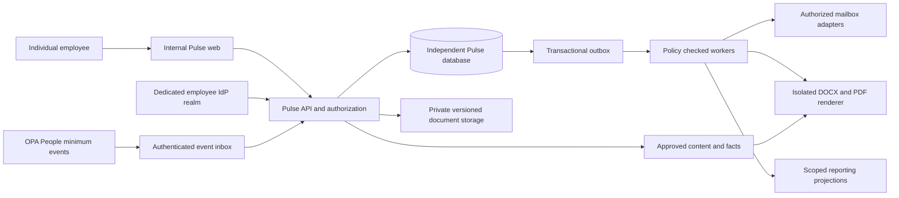

# Software architecture and integration boundaries

## Runtime proposal

Use an independent internal web application and backend modular monolith initially: Identity/Access, CRM, Commercial Catalog/Proposal, Mail, Academy, Workflow and Reporting modules. Separate workers perform provider sync, document rendering, safe scanning, exports and scheduled workflows. PostgreSQL holds transactional state; private object storage holds versioned documents; queue/outbox provides durable execution; permission-filtered search is derived and disposable. Do not share a database, schema, session cookie, OAuth client, signing key, service account or deployment pipeline with emergency/customer systems. Stack choices and versions are implementation decisions after approval.

The diagram describes a future system. No connector or deployment has been configured.

## Boundary decisions

ADR01: employee identity uses a dedicated OIDC issuer/audience and Pulse employee UUID linked to an opaque People employee ID. Reject customer tokens even if they contain similar role names. People is employment source of truth; Pulse owns commercial grants and profile preferences. Manager approval of scope is separate from HR activation. Email/domain alone cannot relink a departed employee to a new hire.

ADR02: server evaluates active employee, organization boundary, action, role, department, territory/account assignment and explicit grants for every object, child, search result, download and job. PostgreSQL row policies provide a second layer; request transactions set scoped context, worker credentials are not universal bypasses. Derived stores keep ACL versions; stale ACL indexes fail closed or recheck the primary store.

ADR03: begin with modular monolith to preserve atomic transitions and lower operations overhead. Mail tokens and untrusted document rendering have separate execution/secret scopes. Extract modules only when throughput or independent ownership justifies it. No internal module may read HR payroll.

ADR04: immutable document/content/quote versions and approval snapshots bind customer-facing claims. The mutable editor never becomes the source of truth for an approved export. Signed URLs are short-lived; review/download permission checked before issuance.

ADR05: transactional outbox + receiver inbox, at-least-once events and unique business-effect keys. No claim of universal exactly-once delivery, especially for remote email sends. Unknown provider send outcomes require reconciliation before retry.

## Integration contracts

| Adapter | Authority and minimal exchange | Recovery / conflict |
|---|---|---|
| People | Signed versioned event: opaque employee ID, employment status, effective time, sequence, manager ID, department, approved business email; no salary, bank, medical or identity documents | Reject replay/stale sequence; suspension wins; urgent deny event fences local account; daily reconciliation catches missing events; gaps alert/fail closed for provisioning |
| Employee IdP | Dedicated issuer, audience, subject, MFA assurance and session ID; local policy epoch checked each request | Unknown employee/status denied; no account auto-link by email; revoke IdP session plus local fence |
| Google Workspace | Per-user OAuth authorization code + PKCE, state, business-domain/tenant validation. Candidate scopes gmail.readonly + gmail.send; drafts stored in Pulse; request gmail.modify only if provider label/read-state write is approved | Bounded initial sync, history cursor, watch renewal, resync after expired history; refresh token encrypted; denied consent means disconnected UI |
| Microsoft 365 | Delegated Mail.Read + Mail.Send and offline_access, OIDC identity scopes; request Mail.ReadWrite only if provider draft/read-state mutations needed; no tenant-wide application mailbox access by default | Per-folder delta checkpoint, subscription renewal and retry, reconnect after invalid consent; use v1.0 API |
| Calendar | Separately consented Google calendar events / Graph Calendars.ReadWrite only when employee enables write; own event/free-busy scope; no HR calendars | Persist provider event mapping and revision; conflicts prompt user; cancel/update explicit user action; timezone and DST tests |
| HubSpot | Companies↔accounts, contacts↔contacts, deals↔opportunities; association mapping for branches/buying committee; owner map to approved employee IDs | Import preview, quarantined invalid rows, external key uniqueness; no implicit delete; per-field authority map, optimistic conflict review and export reconciliation |
| GitHub requests | Allowlisted fields: request ID, industry taxonomy, redacted feature need, internal priority, approved capability reference | Human preview and approval; no raw customer artifacts; scope repo token narrowly, deduplicate by request ID |
| Future OPA Connect | Versioned REST resources and signed events referencing opaque institution/integration IDs only | mTLS/service OAuth audience, scopes, replay protection, version negotiation; no emergency permissions or direct DB links |

Mailbox content starts owner-private, including search and AI context. Explicit CRM link creates a governed immutable communication snapshot with separate record ACL; it does not grant access to the mailbox or future replies. Link preview lists body, participants, attachments and intended audience, with redaction. Automated linking can suggest matches but requires confirmation before sharing. Linked communications retained under company record policy; provider-private cache follows short retention.

## Consistency and resilience

Opportunity stage transition, history append, audit and outbox record commit together. Imports operate in reviewable batches; partial errors are downloadable only to authorized initiators. Reporting projects immutable event time and ingestion time; late events trigger rebuild with revision notice. FX rates and pipeline probabilities are pinned to a forecast snapshot.

Workers claim jobs with lease/heartbeat; unique effect key prevents duplicate local writes. Retry transient 429/5xx with exponential jitter and Retry-After, max 8 attempts / 24 hours proposed; permanent validation/permission errors go to actionable dead-letter queue. Re-evaluate permissions, employee status, approval hash and target record version at execution. Revocation cancels leases through a fencing epoch and blocks token decryption/use. No outbound provider call after a known local suspension.

Cross-boundary revocation cannot guarantee delivery of an event at zero latency. Design SLO: local fence synchronous on receipt, active connection disconnect ≤60 seconds, event delivery ≤60 seconds target. If People lifecycle health is stale >5 minutes, disable new grants and outbound work; security emergency local suspend is always available. A provider call already accepted before suspension cannot be recalled reliably; show and audit this race.

## Operations design

Separate environments/accounts/secrets and backups; synthetic development fixtures only. Monitor authorization-deny spikes, lifecycle heartbeat lag, provider cursor age, revoked send attempts, approval invalidations, export volumes and queue age without message bodies. Correlation IDs connect user action to events/audit/provider metadata. Proposed capacity and recovery objectives are in PRD; restore drills verify DB/object consistency and access fences. Rollback application versions without rolling back audit history or widening permissions. Any future rollout plan requires separate approval and independent pipeline.

## Verified external references (18 October 2026)

- [Gmail synchronization](https://developers.google.com/workspace/gmail/api/guides/sync): partial history can expire; full resync is required on the documented 404 condition.
- [Gmail scopes](https://developers.google.com/workspace/gmail/api/auth/scopes): use minimum scope; restricted-scope verification/security obligations must be assessed for the chosen distribution before implementation.
- [Graph sendMail v1.0](https://learn.microsoft.com/en-us/graph/api/user-sendmail?view=graph-rest-1.0): acceptance is not proof of delivery; expose accepted separately from delivered.
- [Graph message delta](https://learn.microsoft.com/en-us/graph/delta-query-messages): adapter tracks incremental changes within folders.
- [HubSpot data movement](https://developers.hubspot.com/move-data): import/export adapter feasibility reference; entitlements and limits still require account-specific validation.

These are integration design inputs, not confirmation that OPA has provider consent, licenses or approved apps.
